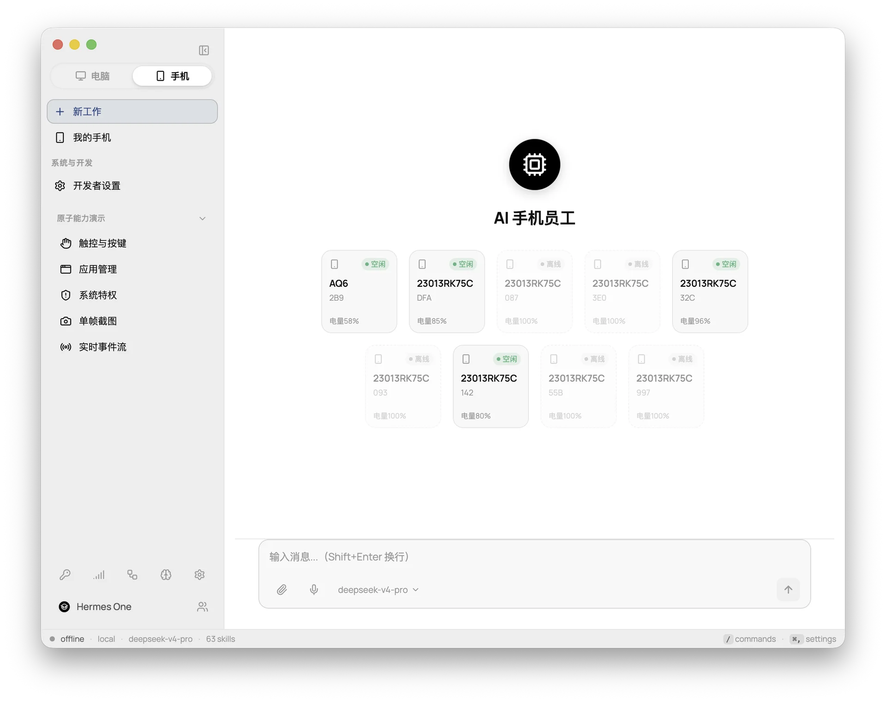
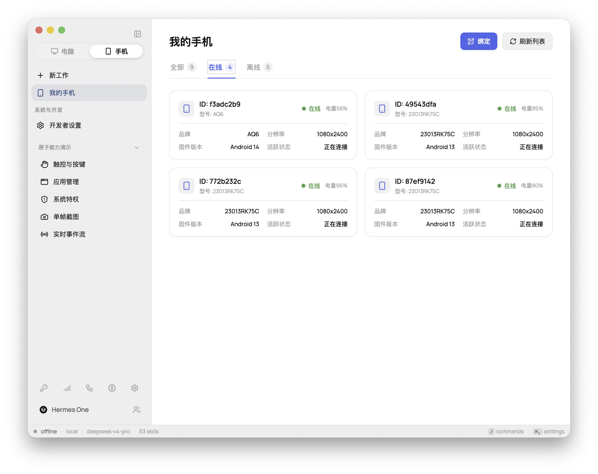
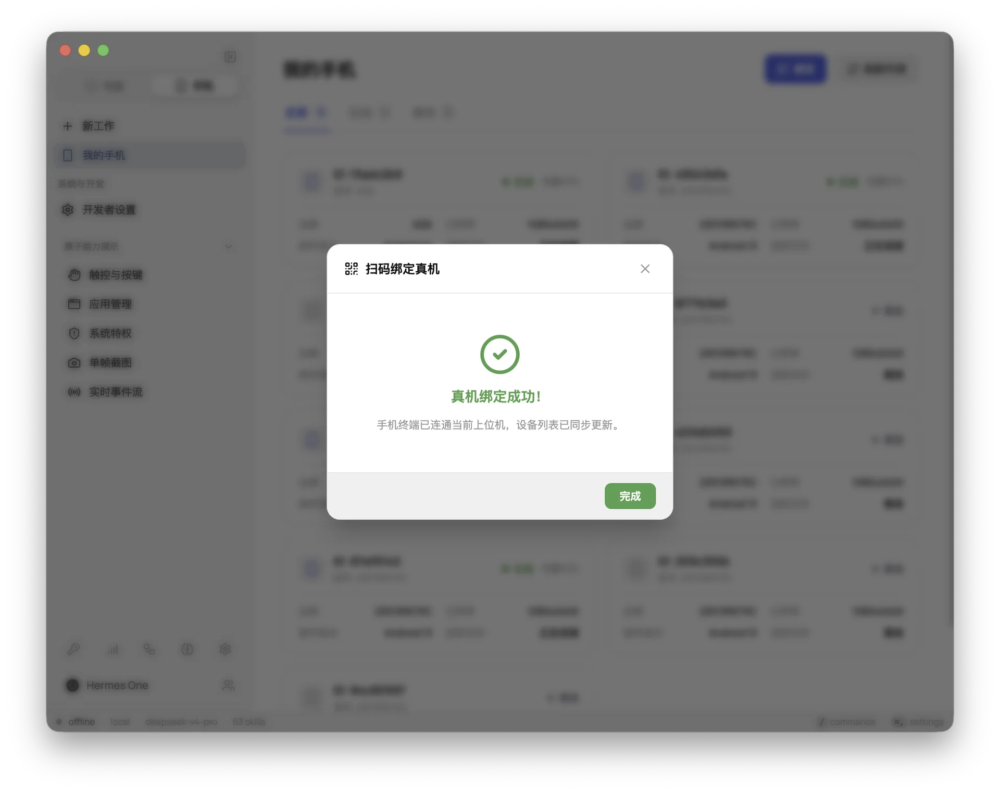
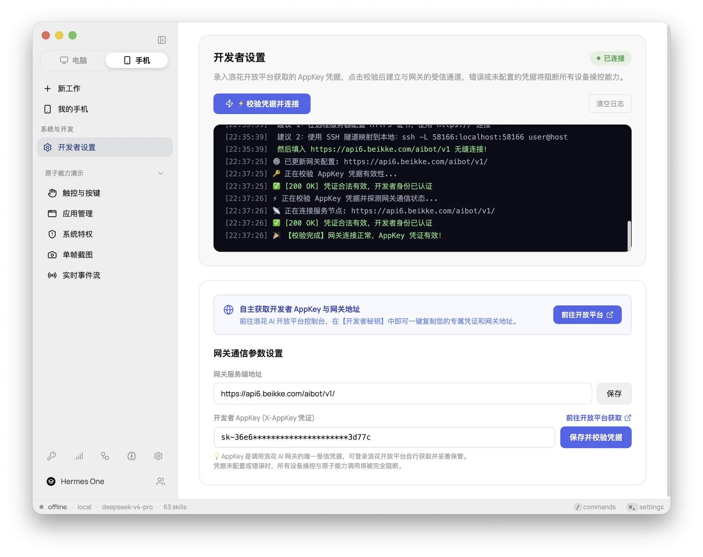
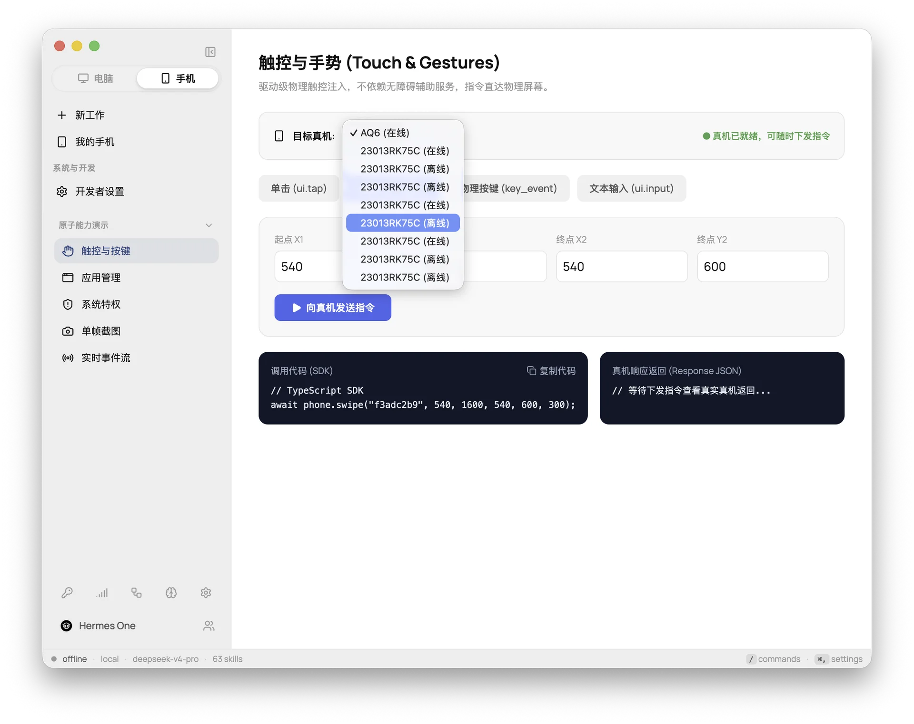
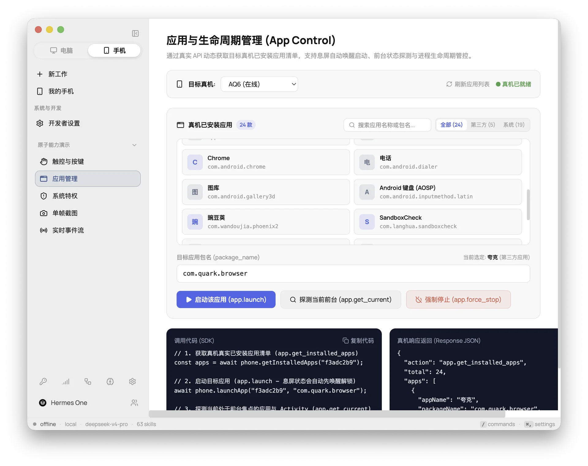
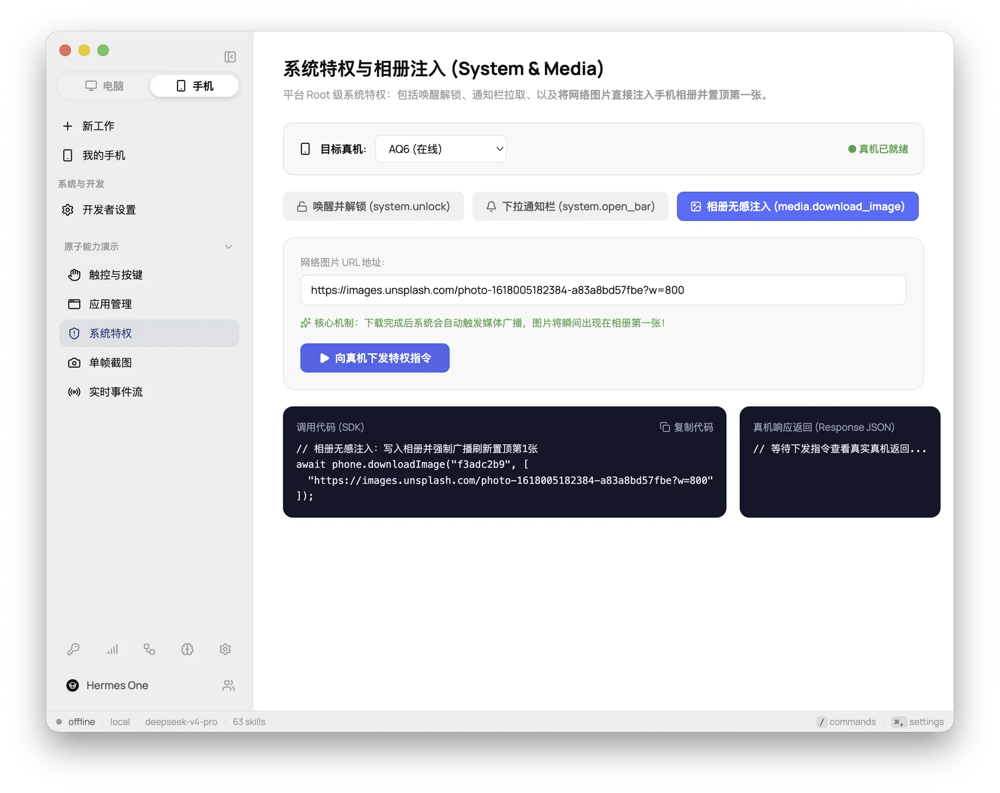
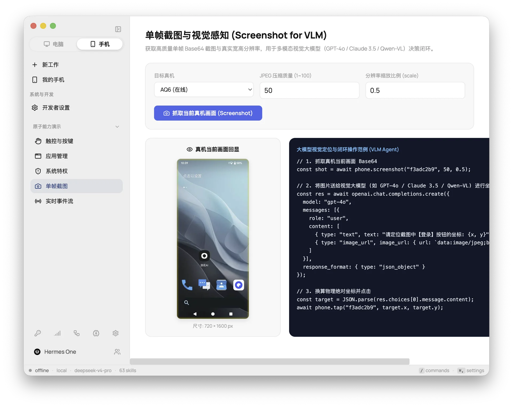
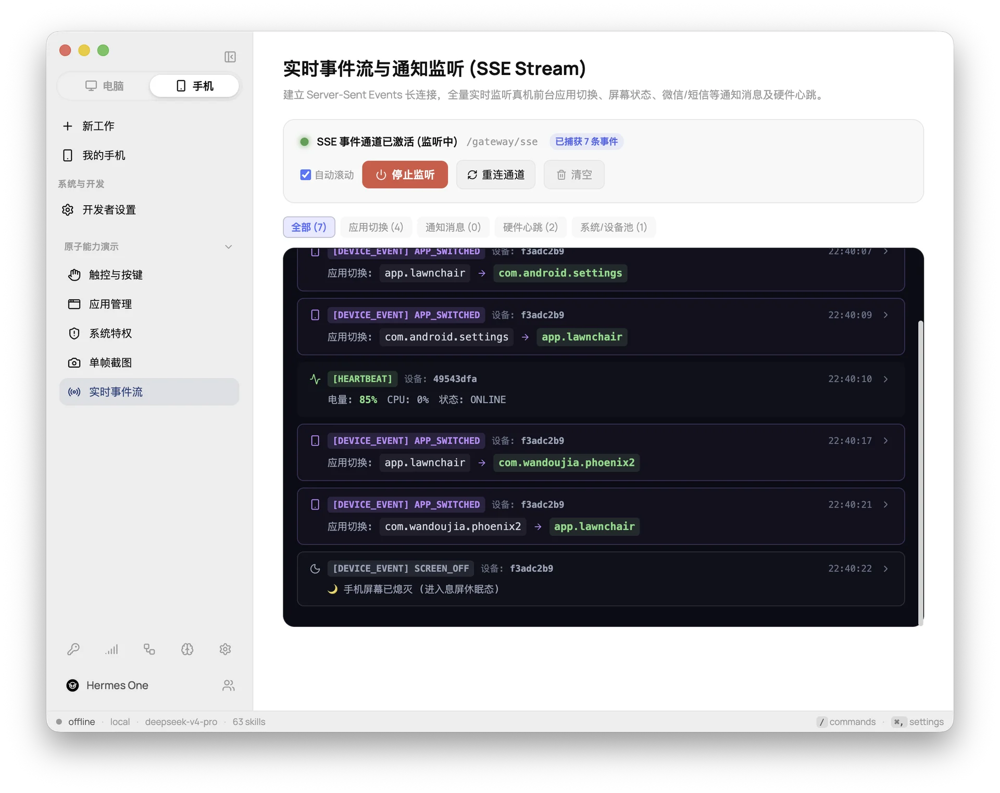

# Hermes Plus — AI 手机与电脑双模智能体桌面端

<p align="center">
  <a href="https://github.com/fathah/hermes-desktop/blob/main/LICENSE"></a>
  <a href="https://nodejs.org/"></a>
  <a href="https://www.electronjs.org/"></a>
  <a href="https://react.dev/"></a>
  <a href="https://bot.beikke.com"></a>
</p>

<p align="center">
  <a href="README.md"><b>English</b></a> ·
  <a href="README.zh-CN.md"><b>简体中文</b></a>
</p>

---

> 🚀 **Hermes Plus** 是一款面向第三方开发者的开源“电脑 + 手机双模智能体”桌面连接器与脚手架，基于官方开源项目 [fathah/hermes-desktop](https://github.com/fathah/hermes-desktop) 构建。  
> 项目在 **100% 完整保留原版桌面端 Agent 体验**（Nous Hermes Agent 驱动）的前提下，通过自包含的手机扩展模块（`phone/`），为开发者提供真机设备发现、毫秒级触控手势物理映射、多模态视觉大模型（VLM）截图闭环感知与 SSE 实时事件流监听。

---

## 🌟 核心特性

### 1. 💻 100% 完整继承原版电脑 Agent 能力
* **完全对齐官方上游**：原版所具备的多模型渠道聚合、会话管理、Memory 记忆系统、MCP 外部工具、定时计划任务（Cron）、16 种消息网关接入及 3D 可视化办公室，均开箱即用、无缝保留。
* **零业务架构偏见（Unopinionated）**：坚决不预设固化的业务流程或 Agent 状态机，第三方开发者可自由选用 LangChain、CrewAI、AutoGen 或自研企业工作流进行二次开发。

### 2. 📱 浪花 AI 手机硬件级连接（`phone/`）
* **丝滑双模切换**：侧边栏顶部一键切换 **[ 💻 电脑 ]** 与 **[ 📱 手机 ]** 模式，像素级复用 macOS / Windows 原生标题栏控件与主题色彩。
* **物理原子能力下发**：提供毫秒级绝对/相对坐标点击（Tap）、多点平滑滑动（Swipe）、文字无输入法键入以及 Android 物理按键（返回、主页、多任务列表）。
* **视觉感知与 VLM 闭环**：单帧高清 Base64 截图抓取与真实屏幕分辨率自动解析，专为多模态视觉大模型（GPT-4o、Claude 3.5 Sonnet、Qwen-VL 等）提供感知闭环支撑。
* **系统特权支撑**：息屏免提权自动亮屏解锁、通知栏与快捷设置面板下拉、网络图片无感注入系统相册。
* **响应式设备管理**：基于 SSE 的长连接架构，设备插拔、在线状态、心跳及剩余电量实时动态更新。

### 3. 🔄 极低侵入性架构（平滑同步上游）
* **模块物理隔离**：所有手机端功能全部收敛在独立的 [`phone/`](./phone) 目录中，不污染上游核心代码。
* **极少改动点**：对官方源码的核心修改严格控制在 3 处（`Layout.tsx` 挂载入口、`start.ts` CSP 放行与 `tsconfig.web.json` 路径包含）。
* **持续跟进官方更新**：当上游发布新特性或修复 Bug 时，可通过 `git merge upstream/main` 几分钟内无冲突完成合并。

---

## 📸 手机端功能实机预览

### 双模切换与设备管理

| 新工作 Agent 工作区 (`01-new-work`) | 真机设备中心 (`02-my-phones`) |
| :---: | :---: |
|  |  |

| 扫码配对弹窗 (`03-binding-modal`) | 开发者网关设置 (`04-gateway-settings`) |
| :---: | :---: |
|  |  |

### 核心原子能力交互演示

| 物理触控与按键下发 (`05-touch-keys`) | 真机应用生命周期管理 (`06-app-control`) |
| :---: | :---: |
|  |  |

| 系统特权与相册注入 (`07-system-priv`) | 单帧截图与 VLM 感知闭环 (`08-screenshot-vlm`) |
| :---: | :---: |
|  |  |

| 实时 SSE 事件流监听 (`09-event-stream`) |
| :---: |
|  |

---

## ⚡ 快速开始

### 1. 克隆代码与安装依赖

```bash
# 克隆仓库
git clone https://github.com/terrancehxx/hermes-plus.git
cd hermes-plus

# 安装依赖 (推荐 Node.js 20+)
npm install
```

### 2. 启动本地开发

```bash
npm run dev
```

### 3. 连接浪花 AI 网关

1. 启动客户端后，点击侧边栏顶部的 **[ 📱 手机 ]** 模式标签。
2. 进入 **开发者设置**（系统与开发 -> 开发者设置）。
3. 配置网关服务端地址（默认为本地开发网关）：
   ```text
   http://localhost:58166
   ```
   *（若使用远程部署实例，请输入 `https://your-gateway.example.com`）*
4. 填入您的开发者 `AppKey`（可在 [浪花开放平台控制台](https://bot.beikke.com/open/appkey) 免费获取）。
5. 点击 **【保存并校验凭据】**，校验通过后右上角即刻点亮绿色 **● 已连接** 状态！

---

## 💻 TypeScript SDK 核心调用范例

客户端提供开箱即用的类型化单例对象 `phoneClient`：

```typescript
import { phoneClient } from "./phone/sdk/phone-client";

// 1. 模拟点击与滑动
await phoneClient.tap("DEVICE_ID", 540, 1200);
await phoneClient.swipe("DEVICE_ID", 540, 1600, 540, 600, 300);

// 2. 启动目标 App 并输入文本
await phoneClient.launchApp("DEVICE_ID", "com.tencent.mm");
await phoneClient.inputText("DEVICE_ID", "你好，来自 Hermes Plus！");

// 3. 单帧抓图并供视觉大模型（VLM）决策
const shot = await phoneClient.screenshot("DEVICE_ID", 50, 0.5);
console.log(`截图尺寸: ${shot.width}x${shot.height}, Base64 大小: ${shot.image_base64.length}`);

// 4. 将 Base64 送给视觉多模态大模型 (GPT-4o / Claude 3.5 / Qwen-VL) 定位元素
const vlmResponse = await openai.chat.completions.create({
  model: "gpt-4o",
  messages: [{
    role: "user",
    content: [
      { type: "text", text: "请定位截图中【搜索】按钮的物理坐标: {x, y}" },
      { type: "image_url", image_url: { url: `data:image/jpeg;base64,${shot.image_base64}` } }
    ]
  }],
  response_format: { type: "json_object" }
});
```

---

## 🔄 上游同步与长期维护

本项目遵循严密的低侵入架构规范（详见 [`UPSTREAM_SYNC.md`](./UPSTREAM_SYNC.md)）。  
当官方发布新版本时，仅需标准 Git 工作流即可完成同步：

```bash
# 添加官方上游仓库（如尚未添加）
git remote add upstream https://github.com/fathah/hermes-desktop.git

# 拉取并合并官方最新代码
git fetch upstream main
git merge upstream/main

# 编译验证
npm run build
```

---

## 📄 开源许可与致谢

- **开源协议**：本项目依据 [MIT License](./LICENSE) 协议发布，完全允许个人与企业免费使用、修改和分发。
- **致谢上游**：感谢 [`fathah/hermes-desktop`](https://github.com/fathah/hermes-desktop) 原作者 Fathah 及 Nous Research 社区打造的高质量桌面应用基座。
- **免责声明**：Hermes Plus 为第三方社区发起的开源扩展项目，并非 Nous Research 官方产品。
